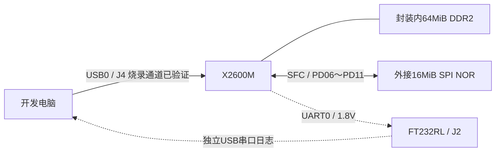

# HALLEY7-M-KIT / X2600M 硬件规格与当前开发配置

> 本文保留各阶段当时的实现与验收范围；当前工程状态见[项目 README](../projects/halley7m-regba/README.md)。`build/` 原始日志、镜像与备份，以及 `Halley7/` 原始硬件资料和本机工具包均在开发机保留，不随源码提交；精选摘要在 `docs/validation/`，其中保留的本地路径用于追溯。

整理日期：2026年10月14日。对象是用户提供板型的 HALLEY7-M-KIT：X2600M、64MB DDR，实板已通过 USB 读取 Flash ID。本文把用户提供的型号、实板读取结果、参考电路和软件配置分别标注；参考电路中的器件与连接器编号需要与实际底板版本对应。

本文是早期硬件勘查快照，下文的 Hello、未装 RTOS、未写 NOR 和待验证状态属于当时。后续主核 FreeRTOS / ReGBA、显示 / 音频 / 存档 / 蓝牙手柄及 NOR 自动启动进展以[项目 README](../projects/halley7m-regba/README.md)为准。屏幕用户标称 TFT FW050，实物型号待背标或厂家资料确认；当前软件使用原 Linux 绑定的 `zc50289hshd02` 初始化与时序，二者不能直接等同。

目前可用一句话描述这块板：**君正 X2600M 多核处理器，内置 64MiB DDR2，外接普冉 16MiB SPI NOR；当前开发目标为 MIPS 主核上的 U-Boot + libbare-cpu 裸机程序。**

实板身份及已确认信息如下。

| 项目 | 当前结论 | 依据与状态 |
| --- | --- | --- |
| 开发板 | HALLEY7-M-KIT | 用户提供的板型 |
| SoC 具体型号 | X2600M | 用户提供的型号，与本地君正 X2600M 板级目标匹配 |
| USB 协议返回的 CPU 名 | `X2600` | 实板 `VR_GET_CPU_INFO` 读取；该字符串不区分 M/N/E/H 后缀 |
| 运行内存 | 64MiB DDR2，67,108,864 字节 | 用户提供 64MB；X2600M 官方 DDR profile 与当前生成参数一致；RAM 辅助程序已成功运行，未做全容量内存测试 |
| 启动 Flash 类型 | SPI NOR | 实板 JEDEC ID 与官方 NOR 表匹配 |
| Flash ID | `0x852018` | 实板读取；USB 原始返回 `18 20 85`，按固件小端整数解码 |
| Flash 识别名 | 普冉 `PY25Q128H` | Cloner 原厂数据库识别名；ID 不能区分全部封装和型号后缀 |
| Flash 容量 | 16MiB，16,777,216 字节，128Mbit | 官方 Cloner ID 条目；与厂商同 ID 系列容量相符 |
| USB 烧录设备 | VID `A108` / PID `EAEF` | 实板 Windows 枚举成功 |
| Windows USB 名称 | `usb cloner device` | `libusb-win32 devices` 类别，设备状态正常、问题代码0 |
| 当前已执行的板上操作 | USB 描述符/CPU 查询、RAM 程序下载运行、Flash ID 读取 | 未擦除、编程或写入 Flash 状态寄存器 |
| 实际烧录与正常启动 | 待验证 | 当前镜像构建完成，未写入 NOR；尚无本板 UART 启动日志 |

原始读取记录：flash-id.json（本地记录 `build/flash-probe/flash-id.json`）。数据库条目：spiflashinfo.cfg（本地依赖 `tools/cloner-windows/cloner-2.5.54-windows_alpha/cloner-2.5.54-windows_alpha/configs/spiflashinfo.cfg:94`）。[普冉 PY25Q128HA 数据手册](https://www.puyasemi.com/download_path/%E6%95%B0%E6%8D%AE%E6%89%8B%E5%86%8C/Flash/PY25Q128HA_Datasheet_V2.3.pdf) 第82页列出相同的 `85 20 18` RDID。64MiB DDR 是运行内存，16MiB NOR 是断电保存程序和数据的存储器。

芯片的处理单元及通用能力如下。额定频率来自 X2600 系列资料，软件当前设定见后面的时钟表。

| 处理单元或功能 | 参数 | 说明 |
| --- | --- | --- |
| 主计算 CPU | XBurst2，32位 MIPS，SMT 逻辑双核，额定 1.2GHz | 一个支持双线程的计算核；当前示例在 MIPS 主核运行 |
| 主核浮点与向量 | 硬件 FPU、MMU、128位 SIMD/MSA/MXA 扩展 | 当前工程编译目标为 MIPS32r2、小端、32位 ABI，编译目标不代表硬件能力上限 |
| 主核 Cache | L1 I-cache 32KiB、L1 D-cache 32KiB、L2 256KiB | 本地板级配置与官方产品页一致 |
| 实时控制核 | Victory0 / RISC-V，额定 600MHz，32KiB SRAM | 有独立 JTAG 调试通道；本次示例尚未运行此核的应用 |
| RISC-V Cache | 精确容量有资料差异 | 用户提供的2023年硬件手册写 I/D 各16KiB；官网与2024年公开 DS 写各8KiB，未据此确认 M 实板硅版本 |
| 安全处理单元 | XBurst0，参考框图标300MHz | 支持安全系统；当前 Cloner 配置关闭安全烧录，实板 EFUSE 内容未读取 |
| 安全功能 | AES、MD5/SHA/SHA2、真随机数、OTP/EFUSE、安全启动 | 属芯片能力；不是当前程序已经启用的功能 |
| 图像处理 | H.264 硬件解码、JPEG 编解码、2D 图形引擎、旋转 | 包括填充、裁剪、缩放、混合等；本次未验证 |
| 调试 | XBurst2 JTAG、RISC-V JTAG | USB 烧录、串口日志与 JTAG 调试是三条不同用途的连接 |
| 封装参考 | BGA-209，11×11mm，0.65mm 球间距，厚度约1.2mm | X2600 公开系列规格；尚未实测本板芯片外形或读取完整订货后缀 |

处理器结构、缓存与通用接口可参照[君正 X2600 产品页](https://www.ingenic.com.cn/products-detail/id-12.html)。[公开 X2600 DS](https://www.lumissil.com/assets/pdf/core/X2600_DS.pdf) 的订货表列出 N/E/H，没有单列 M，因此 DDR2 64MiB 的结论以用户板型和君正 X2600M 专用源码为依据，不用通用 DDR3 订货表替换。

内存的组织和当前时序如下。

| DDR 项目 | 当前值 | 来源与含义 |
| --- | --- | --- |
| 类型 | X2600M 内置/封装内 DDR2 | 君正专用 `X2600M-DDR2` profile |
| 总容量 | 64MiB | `0x04000000` 字节 |
| 总线宽度 | 16bit | `CONFIG_DDR_DW32=0` |
| 片选 | CS0 开启，CS1 关闭 | 一组有效存储 |
| 行/列/Bank | 13行位、10列位、4 banks | `2^13 × 2^10 × 4 × 2字节 = 64MiB` |
| 正常 U-Boot 的 DDR CK | 600MHz | DDR 数据率按双沿传输换算为 1200MT/s，属于当前软件设定 |
| 正常 U-Boot CAS latency | CL9 | 官方生成器输出 |
| Cloner / ID 探测 DDR CK | 400MHz | 对应800MT/s，CL7；已成功运行 RAM 辅助程序 |
| DDR2 VDDMEM 标称电源 | 1.8V | 参考电源设计及 DDR2 供电要求；实板未量测 |
| 物理地址范围 | `0x00000000`～`0x03FFFFFF` | 按当前64MiB容量定义 |
| MIPS KSEG0 缓存映射 | `0x80000000`～`0x83FFFFFF` | 同一块物理 DDR 的虚拟映射，不是额外64MiB |
| Cloner DDR 模板名称 | `DDR2_W9751V6NG.cfg` | 参数模板名；不据此认定本板封装内 DRAM 的完整器件丝印 |

板级依据：x2600_ddr.h（本地依赖 `u-boot-ingenic/include/configs/x2600_ddr.h:8`）、X2600M DDR2 64MiB profile（本地依赖 `u-boot-ingenic/include/ddr/chips-v2/X2600M_DDR2_64M_COMPATIBLE_PARAM.h:235`）、正常启动生成参数（本地记录 `build/uboot-halley7m/include/generated/ddr_reg_values.h:6`）。

当前存在两套时钟，分别用于正常运行与 USB 烧录/RAM 辅助程序。以下均为配置值或按配置推算的值，没有用示波器或频率计测量引脚。

| 时钟项目 | 正常 U-Boot / 当前裸机运行配置 | Cloner 2.5.54 / RAM ID 探测 |
| --- | --- | --- |
| EXTAL 主时钟 | 24MHz | 24MHz |
| CPU / APLL | 1152MHz | 800MHz |
| MPLL | 1800MHz | 1200MHz |
| DDR CK | 600MHz | 400MHz |
| DDR 数据率 | 1200MT/s | 800MT/s |
| EPLL | 300MHz | 本次探测不据此确认 |
| AHB0 | 配置360MHz | 未汇总为本次探测验收项 |
| AHB2 / APB | 配置300MHz / 150MHz | 未汇总为本次探测验收项 |
| SFC 输入时钟 | 配置200MHz | Cloner 配置100MHz；仅 ID 探测的 minimal policy 未发送此参数 |
| NOR SCK | 按驱动四分频推算50MHz | 正常 Cloner 配置推算25MHz；不把此值当作 ID 探测实测频率 |

正常配置见 x2600m_halley7.h（本地依赖 `u-boot-ingenic/include/configs/x2600m_halley7.h:36`），烧录配置见 burner_x2600.h（本地依赖 `tools/cloner-source/cloner-2.5.54-src/u-boot/include/configs/burner_x2600.h:34`）。SFC 的四分频依据是 jz_sfc_common.c（本地依赖 `u-boot-ingenic/drivers/mtd/devices/jz_sfc_v2/jz_sfc_common.c:401`）。库里的 `RISCV_CLK=576MHz` 是另一块 Halley 板标定后写入的计时换算常量，不能据此认定用户实板的 RISC-V 实测频率，见 x2600_ll_risc_ccu.h（本地依赖 `libbare-cpu/drivers/drivers-x2600/include/x2600_ll_risc_ccu.h:49`）。

外部 Flash 的连接、能力和当前用途如下。

| NOR 项目 | 参数 | 状态 |
| --- | --- | --- |
| 识别型号 / ID | `PY25Q128H` / `0x852018` | 已实板读取并匹配原厂数据库 |
| 容量 | 128Mbit = 16MiB | 已匹配 |
| 控制器 | X2600 SFC | 当前板级选 PD 引脚组 |
| 引脚组 | PD06～PD11，FUNC0 | 本地 GPIO 初始化与参考核心板原理图对应 |
| 总线能力 | 标准 SPI、Dual、Quad | 原厂参数表支持；ID 查询只验证单线读 ID |
| 当前烧录/启动方式 | Quad 配置 | 本次尚未做 Quad 写入和正常启动验收 |
| 页编程大小 | 256字节 | Cloner 原厂 ID 条目 |
| 当前擦除块参数 | 32KiB | Cloner 配置和原厂条目；不代表芯片仅支持一种擦除粒度 |
| 功能定位 | 保存 SPL/U-Boot、裸机镜像和数据 | 本次采用从 NOR 装载到 DDR 后执行 |

PD 引脚的信号映射为：PD06=SFC CLK、PD07=DQ0、PD08=DQ1、PD09=DQ3/HOLD、PD10=DQ2/WP、PD11=CE。具体连接见参考核心板第2、4页及 x2600_gpio.c（本地依赖 `u-boot-ingenic/drivers/gpio/jz_gpio/x2600_gpio.c:81`）。

当前准备的 Flash 分区是软件布局，可按后续应用改动，不能当作芯片固定分区。

| 区域 | 起始偏移 | 大小 | 当前内容与状态 |
| --- | --- | --- | --- |
| uboot | `0x000000` | `0x040000`，256KiB | SPL + U-Boot；组合镜像198,780字节 |
| kernel / 裸机应用 | `0x040000` | `0x600000`，6MiB | `halley7m_hello.bin`，15,748字节 |
| rootfs / 剩余空间 | `0x640000` | `0x9C0000`，9.75MiB | 当前禁用烧录 |
| NOR 参数注入区 | `0x5800` | 位于 uboot 区内 | Cloner 按镜像格式注入，不是额外分区 |
| U-Boot 环境区 | `0x3F000` | 位于 uboot 区内 | 同样会被 uboot 分区擦除覆盖 |

当前启动命令是 `sfcnor read 0x40000 0x600000 0x80600000;go 0x80600000`。应用入口在 DDR 的 `0x80600000`；U-Boot负责初始化 DDR 和串口后装载、跳转。烧录配置采用 Part Erase，会改写前6.25MiB；传输检查和 Flash 回读检查已开启。具体镜像与操作见[烧录步骤](烧录步骤.md)。

通用 X2600 的接口资源如下，表示控制器能力；实际可同时使用的接口受封装引脚复用、底板布线、外接模块及驱动影响。

| 类别 | 芯片资源 / 通用能力 | 本次验证范围 |
| --- | --- | --- |
| USB | USB0 OTG；USB1 可配置 Device/Host，参考底板接 Host；USB2.0 | USB0 烧录通讯与 RAM 下载已验证 |
| UART | 8路 | 当前选 UART0/115200/8N1；本板日志串口尚未确认连接 |
| I2C | 4路 | 未测 |
| SPI/SSI | 2路 Master、1路 Slave；Flash另走SFC | 未测通用SPI |
| SD/eMMC/SDIO | 2组控制器 | 核心参考图含eMMC、底板含SDIO扩展；提供图中未见独立TF插槽，实板是否另有TF插槽待确认 |
| Ethernet | 1路10/100Mbps MAC、RMII PHY接口 | 未测 |
| CAN | 2路CAN2.0B，最高1Mbps | 是否有物理收发器取决于底板装配；未测 |
| PWM / TCU | 16路PWM及计数/捕获资源 | 未测 |
| SARADC | 12bit、16通道；手册标最高2Msps、输入0～1.8V | 与GPIO复用；未测 |
| 打印控制器 | 热敏打印头与步进电机控制资源 | 需要外部接口及驱动电路；未测 |
| 显示 | MIPI-DSI、LVDS、RGB、SLCD、串行SPI显示；旋转支持 | 是否连接显示子板和屏待确认 |
| 显示分辨率参考 | MIPI1920×1080@60Hz；LVDS1280×800@60Hz；RGB1280×720@60Hz；SLCD640×480@60Hz | 芯片能力，不能当作用户已连接屏幕的规格 |
| 摄像头 | 8bit DVP | 模组型号、分辨率及当前连接待确认 |
| 音频 | 单声道Codec、I2S、PCM、最多4通道DMIC | 是否连接麦克风、喇叭待确认 |

接口数量和显示能力取自[君正产品页](https://www.ingenic.com.cn/products-detail/id-12.html)，SARADC电气范围取自用户提供硬件手册第19页。官网摄像头条目标640×480@30fps，2024 DS条目标640×480@60fps；本次保留DVP接口结论，不用其中任一帧率承诺用户模块表现。

参考底板中与当前开发最直接相关的连接如下，标号属于 `RD_X2600_HALLEY7_BASEBOARD_V1.0`，需与实板丝印对应。

| 参考底板标号 | 功能 | 与当前开发的关系 |
| --- | --- | --- |
| J1 | DC5V电源输入 | 底板电路标注5V；插座器件额定12V不是本板供电规格 |
| J4 | USB0 Type-C，USB Boot / OTG | 烧录通道，枚举为Cloner设备 |
| J2 | 独立Type-C USB转UART0，U16 FT232RL | 日志调试通道，枚举为串口；与J4分开 |
| J5 | USB1 Type-A Host | 连接USB外设，参考板带VBUS开关/限流电路 |
| J3 | 14针XBurst JTAG | 主核在线调试 |
| J9 | 14针RISC-V JTAG | 实时核在线调试 |
| SW1 | USB BOOT，参考电路拉高PD15/BOOT_SEL1 | 与复位配合切换USB启动 |
| SW2 | RESET | 硬件复位 |
| SW5 | eMMCBOOT，参考电路拉高PD16/BOOT_SEL2 | 不据此认定本板已装eMMC |

参考底板的其他外围与扩展接口如下，同样没有逐项验证用户实板装配或功能。

| 参考底板标号 | 接口/器件与参数 | 原理图页码 |
| --- | --- | --- |
| J25 / U8 / U7 | RJ45；IP101GR百兆PHY、FC1680C网络变压器，RMII连接，参考PHY地址0 | 第5页 |
| J26 | 24针、0.5mm FPC摄像头接口；8bit CIM/DVP、同步/时钟、辅助信号，3.3V及1.8V电源 | 第5页 |
| J6 | 44针RGB显示/扩展排针；LCD D0～23、同步/时钟、I2C0及PWM/UART5/CAN1复用信号 | 第7页 |
| J7 | 30针、0.5mm FPC；4-lane MIPI差分数据与时钟、控制信号、电源 | 第7页 |
| U12 / SPK1 | CS8305E功放和喇叭连接点，输入来自SoC HPOUT差分输出 | 第7页 |
| M1 | 模拟麦克风，接MICLP/MICLN及MICBIAS | 第7页 |
| J17 | 数字麦克风扩展；DMIC_IN0/IN1、CLK、3.3V/GND | 第7页 |
| J10 | 26针Wi-Fi/BT扩展；四位SDIO、UART/流控、32k时钟和控制信号 | 第5页 |
| U14 / Y1 | PCF8563TS/5外部RTC、32.768kHz晶振，I2C1；BT1电池位置标NC | 第4页 |
| SW6 / SW3 / SW4 | 用户按键，分别接PE13/PE14/PE15，1.8V上拉 | 第5页 |
| D5 / D4 | 红色电源灯 / 蓝色PPRST_N相关指示电路 | 第4页 |

参考图引出的CAN1 TX/RX属于控制器信号，图中没有CAN物理收发器或CAN总线端子；电机/打印控制能力也没有配套功率驱动和打印头接口电路。图中有喇叭连接点，没有独立耳机插座。

2026年10月15日用户补充确认：随板Wi-Fi/BT小板使用 **SWT6621-SH**，插在底板 **J10**。当前提供的Wi-Fi扩展原理图画的是AP6212/6223A-SRD，尚未取得SWT6621-SH小板的具体原理图，因此下面的AP6212条目仅保留为参考设计，不能作为用户小板的实际型号和逐针占用记录。

提供的两套扩展图还包含以下可选组件。它们的文件名是X2670 HARE扩展设计，不能仅凭这些图认定用户套件已经附带同一模块和屏幕。

| 扩展参考图 | 已核实的设计内容 | 用户实板尚未确认内容 |
| --- | --- | --- |
| Wi-Fi/BT板 | U1 AP6212，图中还有6223A-SRD替代装配；Wi-Fi四位SDIO、BT UART带RTS/CTS；J1为26针，RFCON1为U.FL；AP6212用26MHz晶振，VDDIO图示3.3V | 是否装配、实际模块型号、天线、驱动与无线功能；不能由BOM名称推断可用FM接口 |
| MIPI屏转接板 | J1/J2各30针、J3触摸接口8针、0.5mm FPC；SGM3752背光驱动、WPM3401A屏电源门控；4-lane MIPI，图中要求软件交换D2/D3差分极性 | 是否附带该转接板，屏幕尺寸/分辨率、触摸控制器型号、与当前底板的引脚对应 |
| MIPI控制信号电平 | 参考图PC15/PC16/PC08及触摸PC17/PC18标3.3V，PE02标1.8V | 实际屏幕信号容限和连线版本 |

核心参考图另画有U4 BIWIN eMMC `BWCMMQ511G08G`、MSC0八位接口；本文不从器件名称推断其容量，用户实板是否装配和容量尚未读取。

烧录、日志与存储的关系可以表示为下图。虚线串口路径表示参考底板提供、目前尚未确认实际连接；J标号属于上述参考底板。

USB/串口/JTAG见参考底板原理图第6页，电源与按键见第4页。J2的FT232RL不是CH340；本机已有COM46是另一设备。芯片侧UART0：PE09=TX、PE10=RX，**1.8V逻辑电平**。参考底板FT232RL的VCCIO由1V8P经供电门控提供，与该电平匹配；不要把Type-C的5V供电理解为UART信号5V。

J10是无线模块连接器，插上小板后不能按底板的UART复用名称直接判断引脚空闲。参考AP6212小板把底板UART2 TX/RX所在的J10第1/2脚用于WL_REG_EN与WL_WAKE_HOST；SWT6621-SH小板是否沿用此分配尚待其原理图确认。按底板PDF导线与引脚节点核对，J10的UART1 TX/RX是 **21/22脚**，CTS/RTS是 **19/23脚**；此前聊天中19/20脚的TX/RX描述有误。J10的UART2 TX/RX为1/2脚。UART5在J6的TX/RX为9/10脚。以上是底板引脚复用位置，尚未据此启用或接线。

供电、启动和引脚复用的关键参数如下。

| 项目 | 参数 | 证据范围 |
| --- | --- | --- |
| 系统输入 | 参考底板DC5V；USB侧VBUS为5V | 图中USB供电到VSYS的D1/D2标NC，是否支持单线整板供电取决于实际装配；未测适配器功率和整板电流 |
| PMIC | 参考核心板U2 G2257Q51U | 第3页，4路DC/DC方案 |
| CPU核心电源 | 标称0.9V | 参考设计；未实测 |
| DDR2 VDDMEM | 标称1.8V | M型号需要DDR2对应电源选配；参考DDR3版的1.5V不可照搬 |
| IO/模拟供电 | 包含1.8V和3.3V两类电源域 | 各GPIO端口电压不同；PE/ADC/UART0侧1.8V |
| VDDIO_CIM / VDDIO_SD | 当前U-Boot配置3.3V / 1.8V | 对应独立IO组，不等于整板所有GPIO电平 |
| BOOT_SEL引脚 | PD14=SEL0、PD15=SEL1、PD16=SEL2 | 复位时采样启动方式 |
| USB Boot选择 | `BOOT_SEL[2:0]=011` 或 `111` | 硬件手册第10页 |
| 当前PD6 SFC启动选择 | 手册表`001`为SFC(PD6)_3.3V | 需与实际按键/上下拉对应，未实测三根启动脚 |
| 复位 | PPRST_N低有效；芯片POR和看门狗可复位 | 手册第9页与参考核心板 |
| IO复用 | 同一引脚可作GPIO或特定外设 | 同时启用接口需核对Pinmux；不能只按控制器数量分配 |

参考核心板第3页中DDR3的反馈电阻装配为R23=100K/R24=150K，对应1.5V；硬件手册第8页说明R24=200K的1.8V选配。这里只记录DDR2与DDR3装配区别，没有对用户实板电阻或电压作测量，也没有要求改动实板。

用户提供的硬件手册和默认核心板原理图描绘256MiB DDR3、`GD5F2GM7UEYIG` 2Gbit SPI NAND参考设计。实板已读取的是16MiB NOR，DDR则按用户板型与X2600M专用profile确认为64MiB DDR2。这些参考图的Flash/DDR默认装配不能覆盖实板记录。

当前开发状态如下。

| 项目 | 状态 |
| --- | --- |
| 主核工具链 | 官方XBurst2 ELF R5.1.6，GCC7.2.0；Windows和WSL/Linux均已部署 |
| 当前运行目标 | libbare-cpu裸机Hello World；libbare-cpu是驱动/支持库，当前工程未装载RTOS |
| Linux/RTOS | 属后续可选软件目标，不能从芯片/板型推断当前Flash内系统 |
| 裸机镜像 | Windows/Linux各15,748字节，SHA256相同 |
| U-Boot镜像 | X2600M Halley7 DDR2 NOR目标，组合198,780字节 |
| 烧录工具 | Windows Cloner2.5.54；DDR2、NOR、两项写入策略已配置 |
| USB驱动 | libusb-win32 1.2.6.1，绑定`oem140.inf`，实板状态正常 |
| RAM运行 / ID查询 | 已完成；未改写Flash |
| 正常NOR启动、UART日志、完整内存测试 | 待验证 |
| 屏幕、摄像头、Wi-Fi/BT、网络、CAN、音频、ADC等 | 当前未做实板功能验证 |

仍需要实板信息才能补齐的项目是：核心板/底板丝印版本、完整SoC订货后缀、已安装的可选子板与模块型号、屏幕/触摸/摄像头规格、eMMC是否装配及容量、UART实际COM号、输入适配器规格、整板功耗，以及接口功能测试结果。公开DS中的温度或封装指标没有用于认定整套开发板及外接模块的温度等级。

本地资料位置：

- 硬件开发手册（本地资料 `Halley7/君正X2600硬件开发手册1.0.pdf`）：第6页处理器框图/指标，第8页电源与主时钟，第9～10页复位与启动，第19页CAN/ADC，第27页GPIO复用。
- 核心板原理图（本地资料 `Halley7/00_COREBOARD/01_SCH/RD_X2600_HALLEY7_COREBOARD_V1.0.pdf`）：第2页CPU数字接口，第3页电源/模拟/DDR参考，第4页Flash参考装配。
- 底板原理图（本地资料 `Halley7/01_BASEBOARD/01_SCH/RD_X2600_HALLEY7_BASEBOARD_V1.0.pdf`）：第4页电源/按键，第6页USB/UART/JTAG。
- MIPI扩展原理图（本地资料 `Halley7/02_MIPI/01_SCH/RD_X2670_HARE_MIPI_V1.0.pdf`）：第1页屏幕、触摸和背光转接。
- Wi-Fi扩展原理图（本地资料 `Halley7/03_WIFI/01_SCH/RD_X2670_HARE_WIFI_V1.0.pdf`）：第1页AP6212与替代装配连接。
- [当前板级烧录配置](../configs/cloner/halley7m-libbare.cfg.in)：镜像路径、DDR、SFC输入时钟及擦除/校验选项。
